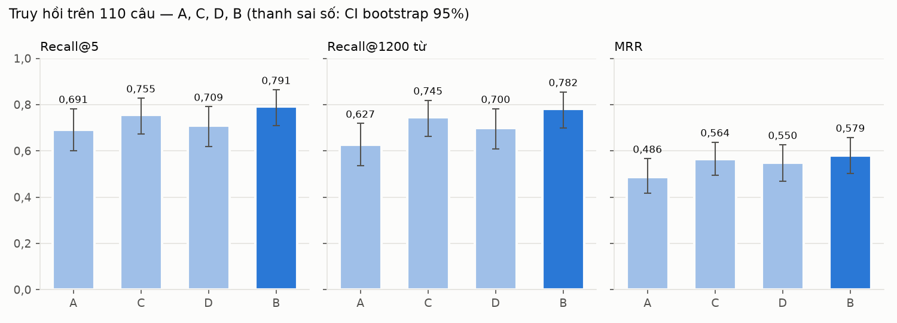
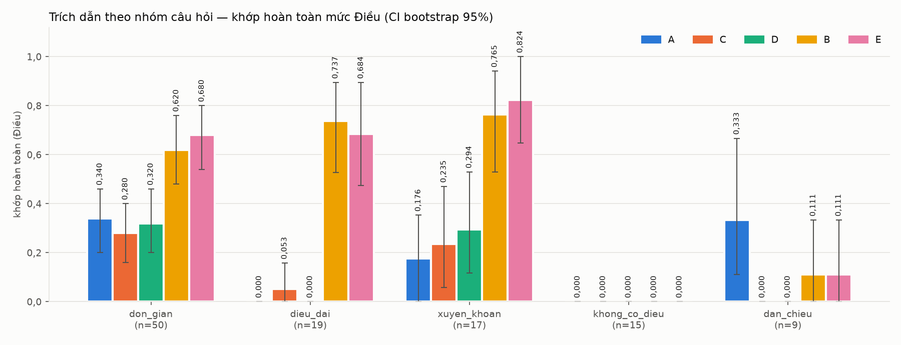
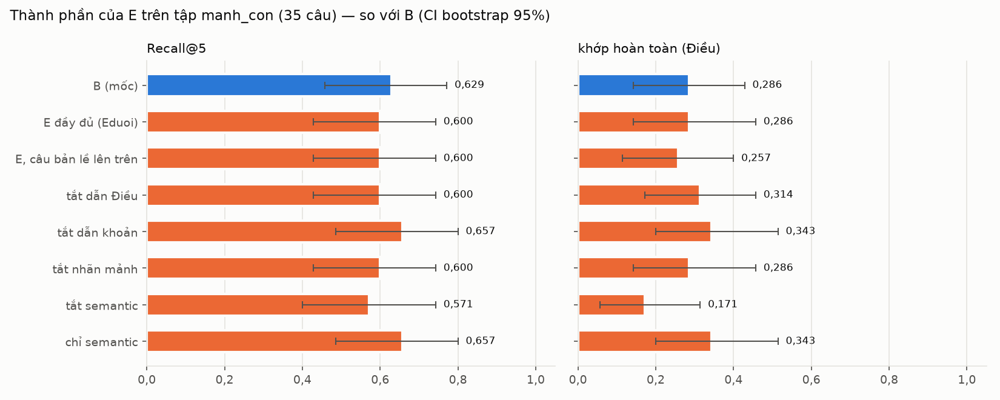

# Báo cáo so sánh phương pháp phân đoạn — bộ số local GPU

Bộ số chính của quyển: `results/local_gpu/` (RTX 2050, Qwen3-4B-Instruct-2507 Q4_0, sinh tham lam, tất định). Bộ VPS (`results/`) chỉ dùng để kiểm chứng tái lập. Tập chính 110 câu, 80 văn bản. Hiệu số dùng bootstrap ghép cặp 95% (1000 lần, phân tầng theo nhóm câu hỏi); **đậm** nghĩa là khoảng tin cậy không chứa 0. Trích dẫn được chấm ở mức Điều theo hai tiêu chí:

- **Khớp hoàn toàn** (tiêu chí chính): trích đủ gold và không trích thừa.
- **Đủ gold** (tiêu chí phụ): trích đủ gold, cho phép thừa.

Lượt bị *cắt trần* (chạm 384 token) và lượt *từ chối* vẫn nằm trong mẫu số. Số liệu lấy từ `results/local_gpu/khoi_so.md`, `metrics_truy_hoi.md`, `metrics_trich_dan.md`, `phan_tich_loi.md`, `thu_them.md` và `chi_tiet_cau.jsonl`. Hình vẽ bằng `python -m eval.ve_hinh`.

Năm phương pháp phân đoạn được so sánh:

- **A**: cửa sổ cố định 300 từ.
- **C**: cửa sổ trượt.
- **D**: phân đoạn ngữ nghĩa.
- **B**: phân đoạn theo cấu trúc Điều → khoản → điểm, mỗi chunk có tiền tố đường dẫn.
- **E**: B cộng ba thành phần bù ngữ cảnh — câu dẫn, nhãn mảnh và tầng cuối cắt ngữ nghĩa.

Ba biến thể mở rộng ngữ cảnh:

- **B+** và **E2**: mở rộng khối truy hồi lên cả Điều cha. B+ dựng trên chunk B; E2 dựng trên chunk E chỉ có tầng cuối ngữ nghĩa (Echi_s).
- **E3**: E2 cộng theo dẫn chiếu tường minh một bước.

---

## 1. A so với B

**Kết luận:** B hơn A rõ ở mọi chỉ số tổng. Về trích dẫn khớp hoàn toàn, B đạt 0,536 so với 0,209 của A (+0,327 [+0,236; +0,409]). Phần lớn khoảng cách nằm ở khâu sinh trích dẫn: truy hồi chỉ hơn +0,100.

| chỉ số (110 câu) | A | B | B − A [95% CI] |
|---|---:|---:|---|
| Recall@5 | 0,691 | 0,791 | **+0,100 [+0,027; +0,164]** |
| Recall@1200 từ (gold vào ngữ cảnh) | 0,627 | 0,782 | **+0,155 [+0,082; +0,227]** |
| MRR | 0,486 | 0,579 | **+0,093 [+0,029; +0,151]** |
| trích dẫn — khớp hoàn toàn | 0,209 | 0,536 | **+0,327 [+0,236; +0,409]** |
| trích dẫn — đủ gold | 0,255 | 0,645 | **+0,391 [+0,300; +0,473]** |
| đạt / từ chối / cắt trần | 96 / 13 / 1 | 103 / 6 / 1 | — |
| Điều tự đoán (không có "Điều N" trong ngữ cảnh) / số Điều được trích | 47 / 115 | 17 / 126 | — |

Gold có thể nghiêng về phía B vì nó được dựng theo đơn vị Điều/khoản, nên tôi tách riêng 34 câu *gold trung lập*: khoảng gold không trùng ranh giới chunk nào của B. Trên tập này, B vẫn hơn A ở trích dẫn: **+0,441 [+0,324; +0,559]** khớp hoàn toàn và **+0,500 [+0,382; +0,618]** đủ gold. Ở truy hồi, hiệu số trên tập này chưa có ý nghĩa thống kê (R@5 +0,118 [+0,000; +0,235], n = 34). Trên 76 câu gold trùng ranh giới, hiệu R@5 có ý nghĩa: **+0,092 [+0,013; +0,171]**.

So với C và D, B hơn rõ ở trích dẫn: +0,364 [+0,264; +0,455] và +0,345 [+0,255; +0,427]. Ở truy hồi, B − C = +0,036 [−0,027; +0,100], chưa có ý nghĩa. B − D có ý nghĩa ở R@5 (+0,082 [+0,009; +0,155]) nhưng không có ý nghĩa ở MRR.

## 2. Năm nhóm câu hỏi

| nhóm | n | A khớp hoàn toàn | B khớp hoàn toàn | B − A [95% CI] | A đủ gold | B đủ gold | B − A đủ gold [95% CI] | cắt trần A / B |
|---|---:|---:|---:|---|---:|---:|---|---|
| don_gian | 50 | 0,340 | 0,620 | **+0,280 [+0,140; +0,420]** | 0,400 | 0,780 | **+0,380 [+0,240; +0,520]** | 1 / 1 |
| dieu_dai | 19 | 0,000 | 0,737 | **+0,737 [+0,526; +0,895]** | 0,000 | 0,789 | **+0,789 [+0,579; +0,947]** | 0 / 0 |
| xuyen_khoan | 17 | 0,176 | 0,765 | **+0,588 [+0,353; +0,824]** | 0,294 | 0,941 | **+0,647 [+0,412; +0,882]** | 0 / 0 |
| khong_co_dieu | 15 | 0,000 | 0,000 | +0,000 [+0,000; +0,000] | 0,000 | 0,000 | +0,000 [+0,000; +0,000] | 0 / 0 |
| dan_chieu | 9 | 0,333 | 0,111 | −0,222 [−0,556; +0,000] | 0,333 | 0,111 | −0,222 [−0,556; +0,000] | 0 / 0 |

B thắng lớn nhất ở hai nhóm mà ranh giới cấu trúc quan trọng nhất:

- **dieu_dai:** A không trích đúng câu nào (0/19).
- **xuyen_khoan:** A trả lời thiếu ở 0,706 số câu, B chỉ thiếu ở 0,059 (B − A = −0,647 [−0,882; −0,412]).

B không thắng ở `khong_co_dieu` và `dan_chieu` (mục 4).

## 3. Vì sao B thắng — cơ chế, kèm ví dụ thật

**(a) Nhãn Điều đi theo chunk.** Mỗi chunk B mang tiền tố `[số hiệu] … > Điều N. <tên> > Khoản k`, nên mô hình chép đúng nhãn này vào trích dẫn. Chunk A là một cửa sổ cắt giữa chừng, thường không có chữ "Điều" nào. Mô hình khi đó phải đoán số Điều từ nội dung, và đoán sai.

- **q120 (dieu_dai).** Câu hỏi: giấy chứng nhận an toàn kỹ thuật cấp trước luật mới còn dùng được đến khi nào. Gold: 36/2024/QH15 Điều 89 khoản 6.
  - Chunk đầu của A bắt đầu bằng *"ngày Luật này có hiệu lực thi hành hoặc đang được đào tạo lái xe…"*, không có nhãn Điều. A trả lời đúng nội dung nhưng trích **"Điều 6 của 36/2024/QH15"**, tức lấy số khoản làm số Điều.
  - Chunk đầu của B là `… > Điều 89. Quy định chuyển tiếp > Khoản 6 6. Chứng nhận chất lượng…`. B trả lời cùng nội dung và trích **"Điều 89 khoản 6"**, khớp gold.
- **Số đo trên cả 110 câu.** Số Điều mà mô hình tự đoán (không xuất hiện trong ngữ cảnh) là 47/115 ở A và 17/126 ở B. Ở C là 59/127, ở D là 58/114: hai phương pháp này cũng không gắn nhãn Điều.

**(b) Một đơn vị pháp lý nằm trọn trong một chunk.** Câu hỏi xuyên khoản cần nhiều khoản cùng lúc. B đưa từng khoản vào như một khối có nhãn riêng; A cắt khoản qua hai cửa sổ.

- **q058 (xuyen_khoan).** Câu hỏi: mức phạt vi phạm phòng cháy chữa cháy khi đã gây thiệt hại và khi mới có khả năng gây thiệt hại. Gold: 100/2015/QH13 Điều 313 khoản 1 và khoản 5.
  - Ngữ cảnh của A là hai cửa sổ giữa Điều 313, chỉ toàn danh sách điểm *"d) Gây thiệt hại về tài sản…"*, không có nhãn. A trích sang bộ luật cũ: **"Điều 240 khoản 1/khoản 4 của 15/1999/QH10"**.
  - Chunk đầu của B là `… > Điều 313. Tội vi phạm quy định về phòng cháy, chữa cháy > Khoản 5`. B trích **Điều 313 khoản 1, 2, 3 và khoản 5 của 100/2015/QH13**.

**(c) Truy hồi chỉ giải thích một phần khoảng cách.** Gold vào được ngữ cảnh ở 0,627 số câu với A và 0,782 với B, hơn nhau +0,155. Trích dẫn hơn nhau +0,327, gấp đôi. Phần chênh còn lại là do ở bước sinh, nhãn đã có sẵn trong ngữ cảnh, như ví dụ (a). Truy hồi vẫn đóng góp thật ở nhóm `don_gian`: R@1200 từ của B hơn A **+0,200 [+0,100; +0,320]**.

## 4. B không thắng ở đâu

1. **`dan_chieu` (9 câu): A hơn B 0,333 so với 0,111.** Khoảng tin cậy chạm 0 (−0,222 [−0,556; +0,000]) và n nhỏ. Hai câu A đúng mà B sai đều cần *hai* Điều nối bằng dẫn chiếu:
   - **q090.** Gold: Điều 248 khoản 2 (nguồn dẫn chiếu) và Điều 132 khoản 2 (đích). Điều 248 có trong ngữ cảnh của B (khối #3), nhưng B chỉ trích đích: *"…các nội dung quy định tại khoản 2 Điều 132…"*.
   - **q093.** Gold: Điều 52 khoản 1 và Điều 49. B trích đúng Điều 52 khoản 1, nhưng trích thừa Điều 48 của Bộ luật Tố tụng dân sự 24/2004/QH11 và thiếu Điều 49.

   Ở truy hồi, A và B ngang nhau trong nhóm này (R@5 0,333 cả hai). Lỗi nằm ở chỗ câu trả lời phải nêu đủ cả nguồn lẫn đích của dẫn chiếu, không phải ở cách cắt B. E3, theo dẫn chiếu một bước, mới đạt 0,222 (mục 5).
2. **`khong_co_dieu` (15 câu): cả tám phương pháp đều 0,000.** Văn bản không chia Điều (thông báo, chỉ thị), vậy mà mô hình vẫn *bịa số Điều*, ví dụ q139 trích *"Điều 5 khoản 2 của 05/TB-VPCP"*. Với B, 15 trong 15 Điều được trích ở nhóm này là Điều tự đoán. Lỗi nằm ở lời nhắc, không nằm ở cách phân đoạn: thêm quy tắc P1 thì B lên 0,133 (mục 6).
3. **Truy hồi so với C.** B − C ở R@5 là +0,036 [−0,027; +0,100], MRR +0,015 [−0,050; +0,084], đều chưa có ý nghĩa. Cửa sổ trượt C truy hồi gần bằng B; C chỉ thua ở trích dẫn (mục 3a).
4. **MRR của `xuyen_khoan`:** A 0,577, B 0,417. Câu cần nhiều khoản làm hạng của *khoản gold đầu tiên* trong B kém hơn, vì mỗi khoản là một chunk riêng cạnh tranh nhau. Recall@5 và trích dẫn của B vẫn cao hơn.
5. **E nhỉnh hơn B nhưng chưa có ý nghĩa thống kê.** Khớp hoàn toàn của E là 0,564, của B là 0,536 (+0,027 [−0,009; +0,073]). Mức này không đủ để nói E thay được B.

## 5. B, B+, E, E2, E3 — trên tập manh_con và trên 110 câu

### 110 câu

| phương pháp | R@5 | gold trong ngữ cảnh | khớp hoàn toàn | đủ gold | đạt / từ chối / cắt trần | − B khớp hoàn toàn [95% CI] | − B đủ gold [95% CI] |
|---|---:|---:|---:|---:|---|---|---|
| B | 0,791 | 0,782 | 0,536 | 0,645 | 103 / 6 / 1 | — | — |
| B+ | 0,791 | 0,764 | 0,436 | 0,518 | 98 / 9 / 3 | **−0,100 [−0,173; −0,018]** | **−0,127 [−0,200; −0,045]** |
| E | 0,782 | 0,782 | 0,564 | 0,664 | 104 / 5 / 1 | +0,027 [−0,009; +0,073] | +0,018 [−0,027; +0,064] |
| E2 | 0,791 | 0,764 | 0,436 | 0,518 | 98 / 9 / 3 | **−0,100 [−0,173; −0,018]** | **−0,127 [−0,200; −0,045]** |
| E3 | 0,791 | 0,755 | 0,491 | 0,536 | 98 / 10 / 2 | −0,045 [−0,127; +0,036] | **−0,109 [−0,182; −0,027]** |

B+ và E2 trùng số với nhau vì 109/110 câu trả lời trùng từng ký tự: khi mở rộng lên cả Điều cha, hai bộ chunk cho ra cùng một văn bản ngữ cảnh. Mở rộng lên Điều làm *giảm* trích dẫn. Ở `dieu_dai`, E2 − B = **−0,421 [−0,684; −0,105]**.

Lý do nằm ở cách trình bày khối: nhãn "Điều N" chỉ đứng ở đầu khối đã mở rộng, nên mô hình gán khoản sang Điều khác. Trong 10 câu "B đúng, E2 dẫn sai", có 9 câu là dẫn nhầm Điều. Ví dụ q039: gold Điều 46 khoản 3, E2 trích "Điều 3 khoản 3". Biến thể E2n (mục 6) xác nhận đúng cơ chế này. E3 hơn E2 nhờ theo dẫn chiếu: **+0,055 [+0,009; +0,100]**.

### manh_con (35 câu nhắm vào chỗ B cắt mất ngữ cảnh)

| phương pháp | R@5 | gold trong ngữ cảnh | khớp hoàn toàn | đủ gold | đạt / từ chối / cắt trần | − B khớp hoàn toàn [95% CI] | − B đủ gold [95% CI] |
|---|---:|---:|---:|---:|---|---|---|
| B | 0,629 | 0,629 | 0,286 | 0,457 | 26 / 8 / 1 | — | — |
| B+ | 0,629 | 0,457 | 0,229 | 0,286 | 24 / 11 / 0 | −0,057 [−0,200; +0,086] | **−0,171 [−0,314; −0,029]** |
| E (Eduoi) | 0,600 | 0,600 | 0,286 | 0,400 | 28 / 6 / 1 | +0,000 [−0,143; +0,171] | −0,057 [−0,257; +0,143] |
| E2 | 0,657 | 0,514 | 0,229 | 0,286 | 26 / 9 / 0 | −0,057 [−0,200; +0,086] | **−0,171 [−0,314; −0,029]** |
| E3 | 0,657 | 0,514 | 0,257 | 0,286 | 25 / 10 / 0 | −0,029 [−0,171; +0,114] | **−0,171 [−0,314; −0,029]** |

Bảng thành phần (khoi_so.md, khối 6) cho thấy:

- **Tắt tầng cuối ngữ nghĩa (Etat_s)** là thay đổi duy nhất làm E xấu đi có ý nghĩa: khớp hoàn toàn 0,171, so với E đầy đủ là −0,114 [−0,229; −0,029] và so với B cũng −0,114 [−0,229; −0,029].
- **Chỉ giữ tầng cuối ngữ nghĩa (Echi_s, không bù câu dẫn và nhãn mảnh)** cho số cao nhất: 0,343, hơn B +0,057 [−0,057; +0,200]. Khoảng tin cậy vẫn chứa 0.

Trên 35 câu, chưa thành phần nào thắng B có ý nghĩa. Phần bù câu dẫn cũng không cho thấy tác dụng: E đầy đủ và Echi_s gần nhau.

## 6. Kết luận

**Kết luận chính.** Trên văn bản quy phạm pháp luật tiếng Việt, phân đoạn theo cấu trúc (B) hơn cửa sổ cố định (A) **+0,327** về trích dẫn khớp hoàn toàn và **+0,100** về Recall@5. Kết luận vẫn đúng khi chỉ xét gold trung lập (+0,441). Nó cũng không phụ thuộc seed phân đoạn: B không có seed; E (dựng trên B) hơn A có ý nghĩa ở cả bốn seed của A, từ +0,318 đến +0,355. Phần lớn lợi thế đến từ việc nhãn Điều/khoản đi theo chunk, nên mô hình sinh trích dẫn đúng. Truy hồi chỉ đóng góp phần nhỏ hơn. E (B cộng bù ngữ cảnh) không hơn B có ý nghĩa thống kê.

**Còn yếu ở đâu**

- **Dẫn chiếu.** Nhóm `dan_chieu` chỉ đạt 0,111 với B và 0,222 với E3. Trên 26 câu có dẫn chiếu, E3 theo được 73 lượt dẫn chiếu nhưng phải bỏ 27 lượt vì hết ngân sách 1.200 từ.
- **Văn bản không chia Điều.** Mô hình bịa số Điều. Lời nhắc P1 sửa được một phần, nhưng nhóm này vẫn chỉ đạt 0,133.
- **Mở rộng lên Điều cha (B+ / E2)** có hại nếu không gắn lại nhãn khoản.
- **Cỡ mẫu nhỏ.** Các nhóm 9–19 câu và tập manh_con 35 câu cho khoảng tin cậy rộng. Mọi kết luận theo nhóm, trừ `dieu_dai` và `xuyen_khoan`, chỉ nên coi là gợi ý.
- **Bộ bóc trích dẫn bằng regex** khớp 0,825 [0,747; 0,883] với 120 nhãn tay, nên số trích dẫn có sai số đo của riêng nó.

**Thử thêm cho thấy gì** (`thu_them.md`). Mỗi thử nghiệm có kiểm soát chạy lại cùng lượt; 14 biến kiểm soát × 110 câu trùng từng ký tự với bước 1.

| thử nghiệm | kết quả chính [95% CI] |
|---|---|
| seed phân đoạn (4 seed) | A dao động: độ lệch chuẩn 0,016, 37/110 câu đổi kết quả. E không đổi (0/110). Hiệu E − A có ý nghĩa ở cả 4 seed |
| ngân sách 600 / 1.800 / 2.400 từ | Không đổi có ý nghĩa với B và E2, ví dụ B·2.400 − B·1.200 = −0,018 [−0,082; +0,036]. Lượt 2.400 từ chạy n_ctx 8192, kèm kiểm soát 1.200 từ trên cùng server (trùng 110/110) |
| mô hình sinh 4B Q4_K_M / 8B Q4_K_M | Không giúp. B·8b − B·4b = −0,055 [−0,136; +0,027]; E3·8b − E3·4b = **−0,118 [−0,191; −0,045]**. 8B chạy 12/37 lớp trên GPU, 17,5 s/câu |
| lời nhắc P1 (cấm tự đặt số Điều) | B **+0,064 [+0,018; +0,118]**, E **+0,055 [+0,009; +0,109]**. `khong_co_dieu`: C, B, B+, E, E2 từ 0,000 lên 0,133; E3 từ 0,067 lên 0,200; D từ 0,000 lên 0,067; A giữ 0,000. Tổng 110 câu của A, C, D không đổi có ý nghĩa |
| E2n (gắn lại nhãn "(Điều N khoản k)" cho từng khoản trong khối mở rộng) | E2n − E2 = **+0,073 [+0,009; +0,136]**. Cứu được 8/10 câu "B đúng, E2 dẫn sai". `dieu_dai` từ 0,316 lên 0,684. Vẫn chưa hơn B: −0,027 [−0,091; +0,045] |
| bỏ cụm sáo khỏi chuỗi nhúng (Bloc) | Không tác dụng: R@5 +0,000, MRR −0,001 [−0,005; +0,002] |

Hai cải tiến có ý nghĩa thống kê là P1 trên B và E, và E2n so với E2. Cả hai đều sửa ở *cách trình bày nhãn cho mô hình sinh*, không sửa ở truy hồi. Điều này khớp với cơ chế ở mục 3: nút thắt của trích dẫn pháp luật nằm ở chỗ nhãn Điều/khoản có đến được mô hình đúng chỗ hay không.
